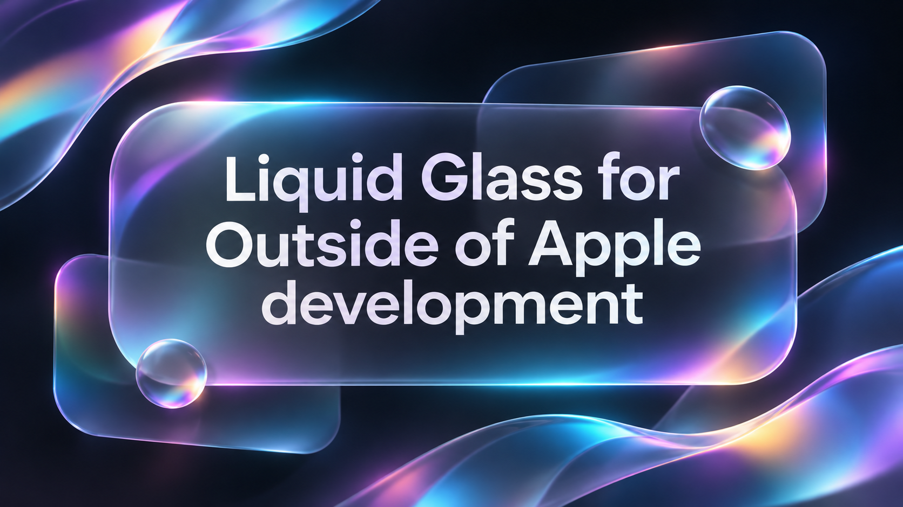
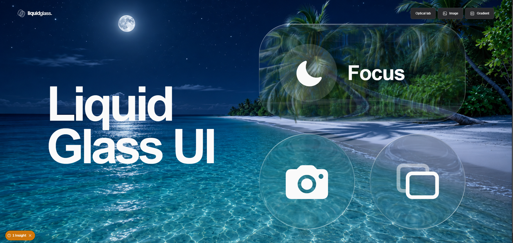
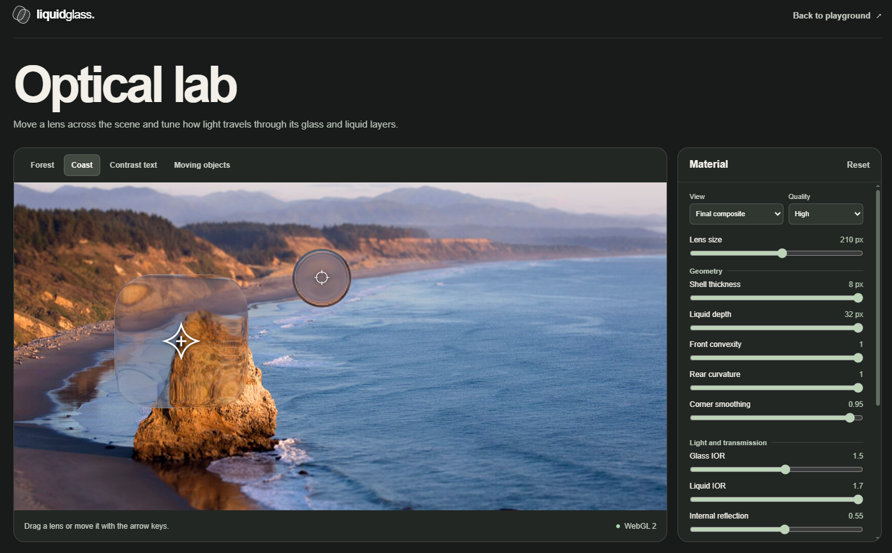
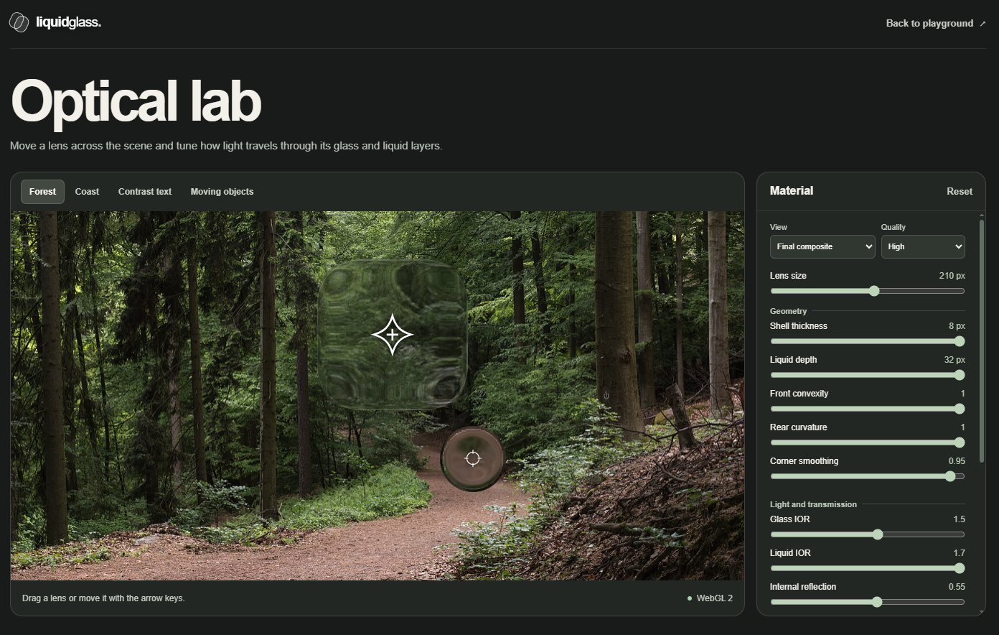

# Liquid Glass UI



A Next.js playground based on the supplied liquid-glass reference, with a neutral
charcoal background and local image / custom gradient controls.

## Screenshots







## Run locally

Requires Node.js 20.9 or newer. Node.js 24 is recommended for this checkout.

```powershell
npm.cmd ci
npm.cmd run dev
```

Open <http://127.0.0.1:3000>. If the port is busy, Next.js prints the selected port.
On macOS/Linux, use `npm` in place of `npm.cmd`.

```powershell
npm.cmd run type-check
npm.cmd run lint
npm.cmd run build
npm.cmd start
```

The development and production servers bind to loopback by default.

## Controls

- **Image** opens a local image picker. Images stay in the browser and are not uploaded.
- **Gradient** opens six presets, three color pickers, and a direction slider.
  Changes preview immediately. Done, Escape, or clicking outside closes the editor.
- **Focus** toggles a dimmed background and heading.
- **Camera** also opens the image picker.
- **Overlapping squares** switch between the default clear preset and frosted glass.

Image and gradient selections last for the current page session. Reloading restores
the Graphite background. Image backgrounds use centered `cover` sizing.

See [the complete handover](Readme%20files/README.md) for architecture, verification,
limits, and the manual browser checklist.

## Optical lab

Open **Optical lab** from the home page or visit `/optics`. Drag either lens, or
focus it and use the arrow keys (hold Shift for a larger step). Select Forest,
Coast, Contrast text, or Moving objects. The motion scene can be paused and
follows the system reduced motion preference. The Material inspector exposes
the calibration values, eight diagnostics, two quality modes, and a lens
size slider to preview material scaling and edge lighting.

`LiquidGlassSurface` uses the `volumetricLiquidGlass` preset when it is inside
an `OpticsProvider`. Pass a partial `material` to override optical parameters,
`opticalShape="circle"` for round controls, or `opticalProfile="sheet"` to
select the original large-panel material. The automatic profile blends the
two materials between effective sizes of 154 and 305 CSS pixels. The effective
size accounts for both area and the longest side. The lab preview and home
controls retain the ray geometry and material blend of a 222 CSS pixel lens
when enlarged. Larger lenses keep the original rim highlight at their display
size. The home preset uses Performance mode. Foreground HTML stays outside
the optical render pass.

The WebGL 2 renderer intersects four independent height fields. It uses
dielectric Fresnel, Snell refraction, bounded reflection paths, and
Beer–Lambert extinction along the traced liquid path. The caustic diagnostics
show the local area change in the transmitted backdrop samples. This is a
screen-space approximation. Reflection branches use the environment available
in the same scene texture, and screen edges clamp the sample. The renderer
does not capture arbitrary DOM, reflections between components, or off-screen
geometry. Home image sampling uses a decoded still image for animated GIFs.

Each scene paints and uploads one shared texture, reusing it for static
backdrops even when a lens moves. High quality uses more intersection
iterations, traces multiple reflected branches, and samples chromatic
dispersion. Performance mode lowers the pixel budget and uses the strongest
reflected branch. Rendering sleeps between updates for static scenes. Frame
rate depends on GPU, viewport, and the number and size of the visible lenses.

When WebGL 2 is unavailable or the context is lost, the previous SVG
displacement and CSS backdrop-filter layers provide an approximation.
The text and motion scenes use the CSS filter directly in this case. The
fallbacks do not trace optical interfaces or show physics diagnostics. If
neither SVG filters nor CSS backdrop filtering are available, basic
translucent CSS keeps foreground controls readable.

Backdrop photographs are stored locally:

- [Forest path and trees](https://commons.wikimedia.org/wiki/File:Forest_path_and_trees.jpg)
  by Denis Zastanceanu, [CC BY-SA 4.0](https://creativecommons.org/licenses/by-sa/4.0/).
  The included JPEG is the 1,280-pixel rendition.
- [Ocean coast at beach](https://commons.wikimedia.org/wiki/File:Ocean_coast_at_beach_(Unsplash).jpg)
  by Tim Mossholder, [CC0 1.0](https://creativecommons.org/publicdomain/zero/1.0/).
